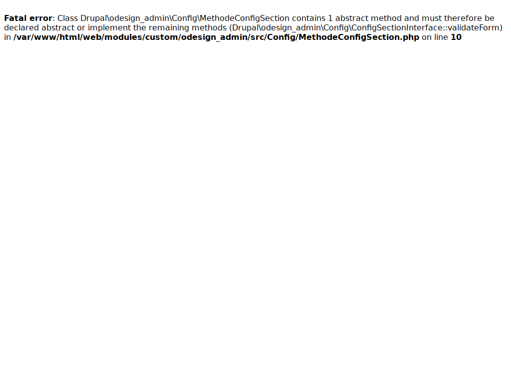

# Configuration de la boutique

> 📍 **Accès** : Tableau de bord → **Configuration boutique**
> **URL directe** : `/admin/boutique/configuration`

## Ce que vous pouvez faire ici

Cette page regroupe tous les réglages essentiels de votre boutique : les informations générales, les emails, le paiement, l'apparence de la page d'accueil et les promotions groupées. C'est votre panneau de contrôle central.

---

## Onglet "Boutique" — Informations générales

### Modifier le nom ou l'adresse email de la boutique

1. Aller sur `/admin/boutique/configuration`
2. Cliquer sur l'onglet **Boutique**
3. Modifier le champ **Nom de la boutique** si besoin
4. Modifier le champ **Email de contact** (adresse affichée dans les emails envoyés aux clients)
5. Modifier le champ **Adresse d'expédition des emails** si vous souhaitez utiliser une adresse d'envoi différente
6. Cliquer sur **Enregistrer**

> 💡 **Astuce** : L'email de contact apparaît dans les messages automatiques envoyés à vos clients (confirmation de commande, etc.). Utilisez une adresse que vous consultez régulièrement.

---

## Onglet "Emails" — Configuration de l'envoi

### Vérifier ou mettre à jour les paramètres d'envoi d'emails

1. Aller sur `/admin/boutique/configuration`
2. Cliquer sur l'onglet **Emails**
3. Vérifier les champs **Identifiant SMTP Brevo** et **Clé SMTP Brevo** (ces informations vous ont été transmises lors de la mise en service)
4. Le champ **Adresse d'expédition** est l'adresse visible par vos clients comme expéditeur

> ⚠️ **Attention** : Ne modifiez pas la clé SMTP Brevo sans avoir les nouvelles valeurs sous la main. Une mauvaise valeur bloque l'envoi de tous les emails de la boutique (confirmations de commande, etc.).

### Tester l'envoi d'email

1. Dans l'onglet **Emails**, remplir le champ **Adresse de test** avec votre adresse email personnelle
2. Cliquer sur **Tester l'envoi d'email**
3. Vérifier que vous recevez bien le message de test dans votre boîte mail (vérifiez aussi les spams)

> 💡 **Astuce** : Faites ce test après chaque modification des réglages email pour vous assurer que tout fonctionne.

---

## Onglet "Paiement" — Clés Stripe

> ⚠️ **Attention** : Cette section contient des informations sensibles liées au paiement en ligne. Ne communiquez jamais ces clés à quiconque. Ne les modifiez pas sans accompagnement technique.

Les champs **Clé publiable**, **Clé secrète** et **Webhook secret** sont configurés lors de la mise en service. Si vous avez besoin de les mettre à jour (renouvellement de clés Stripe), contactez votre prestataire technique.

---

## Onglet "Page d'accueil — Hero" — Image et texte d'accueil

### Modifier l'image de fond de la page d'accueil

1. Aller sur `/admin/boutique/configuration`
2. Cliquer sur l'onglet **Page d'accueil — Hero**
3. Activer ou désactiver **Afficher une image de fond** selon votre choix
4. Si activé, cliquer sur **Photo de fond** pour téléverser une nouvelle image (formats acceptés : JPG, PNG — recommandé : au moins 1400 px de large)
5. Choisir la **Couleur du texte** (clair ou foncé) selon le contraste avec votre image
6. Cliquer sur **Enregistrer**

> 💡 **Astuce** : Une image lumineuse avec du texte foncé ou une image sombre avec du texte clair améliorent la lisibilité sur votre page d'accueil.

---

## Onglet "Je me présente" — Section présentation

### Modifier votre texte de présentation

1. Aller sur `/admin/boutique/configuration`
2. Cliquer sur l'onglet **Je me présente**
3. Modifier le champ **Titre section** (ex. : "Bonjour, je suis Océane")
4. Modifier le champ **Texte de présentation** avec votre message
5. Cliquer sur **Photo de la fondatrice** pour mettre à jour votre portrait
6. Modifier le champ **Titre vidéo de fabrication** si vous avez intégré une vidéo de votre atelier
7. Cliquer sur **Enregistrer**

---

## Onglet "Comment ça marche" — Les étapes de votre processus

### Modifier les étapes de fabrication expliquées aux clients

1. Aller sur `/admin/boutique/configuration`
2. Cliquer sur l'onglet **Comment ça marche**
3. Modifier le **Titre section** et le **Sous-titre**
4. Pour chacune des 3 étapes, modifier le **Titre**, la **Description** et l'**Icône**
5. Cliquer sur **Enregistrer**

> 💡 **Astuce** : Ces étapes rassurent vos clients sur votre processus artisanal. Des phrases courtes et concrètes sont plus efficaces (ex. : "Vous choisissez le prénom", "Je grave à la main", "Je vous envoie votre colis").

---

## Onglet "Promotions volume" — Réductions pour les achats en quantité

### Activer ou modifier une réduction par quantité

1. Aller sur `/admin/boutique/configuration`
2. Cliquer sur l'onglet **Promotions volume**
3. Pour chaque règle (jusqu'à 3), vous pouvez :
   - Cocher **Activer** pour l'activer ou la désactiver
   - Modifier le **Nom commercial** (ex. : "-5% dès 3 articles")
   - Définir la **Cible** (nombre d'articles à partir duquel la réduction s'applique)
   - Choisir les **Univers ciblés** et les **Produits ciblés** si la réduction ne s'applique qu'à une partie du catalogue
4. Cliquer sur **Enregistrer**

> 💡 **Astuce** : Les promotions volume s'appliquent automatiquement au panier sans que le client ait besoin d'un code promo.

---

*Documentation Atelier O Design — Configuration boutique — v1.0*
