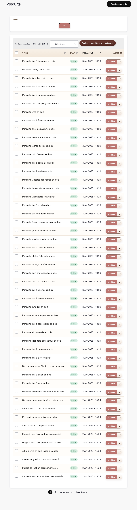

# Gestion des produits

> 📍 **Accès** : Tableau de bord → **Produits**
> **URL directe** : `/admin/commerce/products`

## Ce que vous pouvez faire ici

Vous pouvez consulter, modifier et créer les fiches produit de votre boutique. Vous pouvez également masquer temporairement un produit sans le supprimer, gérer ses photos et ses variantes (tailles, couleurs, options).

---

## Voir la liste des produits

1. Aller sur `/admin/commerce/products`
2. La liste affiche tous vos produits avec leur titre, leur statut (publié ou non) et leur prix
3. Vous pouvez filtrer par **statut** pour voir uniquement les produits publiés ou ceux en brouillon

---

## Modifier un produit existant

1. Sur `/admin/commerce/products`, trouver le produit à modifier
2. Cliquer sur **Modifier** à droite du produit
3. Vous pouvez modifier :
   - **Titre** : le nom du produit tel qu'il apparaît sur la boutique
   - **Description** : le texte de présentation du produit (utilisez la barre d'outils pour mettre en forme)
   - **Images** : les photos du produit (voir section "Gérer les photos" ci-dessous)
   - **Prix** : dans la section **Variantes**
4. Cliquer sur **Enregistrer** pour sauvegarder vos modifications

> 💡 **Astuce** : Toutes vos modifications sont sauvegardées uniquement lorsque vous cliquez sur **Enregistrer**. Si vous fermez la page sans sauvegarder, vos changements seront perdus.

---

## Gérer les photos d'un produit

### Ajouter ou remplacer une photo

1. Dans la fiche de modification du produit, trouver la section **Images**
2. Cliquer sur **Ajouter un fichier** pour téléverser une nouvelle photo depuis votre ordinateur
3. Formats acceptés : JPG, PNG — taille recommandée : carré de 1000 × 1000 px minimum
4. Pour remplacer une photo existante, cliquer sur **Supprimer** à côté de la photo puis en ajouter une nouvelle
5. Cliquer sur **Enregistrer**

> 💡 **Astuce** : Des photos carrées sur fond neutre (blanc ou beige clair) mettent mieux en valeur vos créations et s'intègrent harmonieusement dans la grille de la boutique.

---

## Modifier le prix d'un produit

1. Dans la fiche de modification du produit, descendre jusqu'à la section **Variantes**
2. Cliquer sur **Modifier** à côté de la variante dont vous souhaitez changer le prix
3. Modifier le champ **Prix**
4. Cliquer sur **Mettre à jour** puis sur **Enregistrer** sur la fiche principale

> 💡 **Astuce** : Si votre produit a plusieurs variantes (ex. : différentes tailles ou personnalisations), chaque variante peut avoir son propre prix.

---

## Créer un nouveau produit

1. Aller sur `/admin/commerce/products`
2. Cliquer sur **Ajouter un produit**
3. Remplir les champs :
   - **Titre** : le nom du produit (ex. : "Hochet personnalisé en bois")
   - **Description** : présentez le produit, les matières utilisées, les options de personnalisation
   - **Images** : ajoutez au moins une photo
4. Dans la section **Variantes**, définir le prix et le stock si nécessaire
5. Cocher **Publié** si vous souhaitez que le produit apparaisse immédiatement sur la boutique
6. Cliquer sur **Enregistrer**

> 💡 **Astuce** : Laissez le produit en brouillon (sans cocher "Publié") si vous n'avez pas encore toutes les informations ou photos. Vous pourrez le publier plus tard.

---

## Masquer un produit (dépublier)

Dépublier un produit le retire de la boutique sans le supprimer définitivement. Utile si un article est temporairement en rupture ou en pause.

1. Sur la liste des produits, trouver le produit à masquer
2. Cliquer sur **Modifier**
3. Décocher la case **Publié** (elle se trouve en haut à droite ou en bas du formulaire)
4. Cliquer sur **Enregistrer**

Le produit disparaît de la boutique mais reste dans votre liste d'administration avec le statut **Non publié**.

> 💡 **Astuce** : Pour remettre le produit en ligne, répétez la même opération en cochant à nouveau **Publié**.

---

## Supprimer un produit

> ⚠️ **Attention** : La suppression d'un produit est **irréversible**. Le produit et toutes ses données (photos, variantes, historique) seront définitivement effacés. Préférez la dépublication si vous souhaitez conserver la possibilité de le remettre en ligne.

1. Sur la liste des produits, cliquer sur **Supprimer** à droite du produit
2. Confirmer la suppression dans le message qui apparaît

---

## Gérer les attributs produit

Les attributs sont les options proposées à vos clients lors de l'achat (ex. : "Prénom à graver", "Couleur", "Taille").

1. Aller sur `/admin/commerce/product-attributes`
2. Vous pouvez voir les attributs existants et leurs valeurs
3. Pour modifier les valeurs d'un attribut, cliquer sur **Modifier**
4. Ajouter ou supprimer des valeurs selon vos besoins
5. Cliquer sur **Enregistrer**

> ⚠️ **Attention** : Modifier ou supprimer un attribut qui est utilisé sur des produits existants peut affecter l'affichage de ces produits sur la boutique. Procédez avec précaution.

---

*Documentation Atelier O Design — Produits — v1.0*
