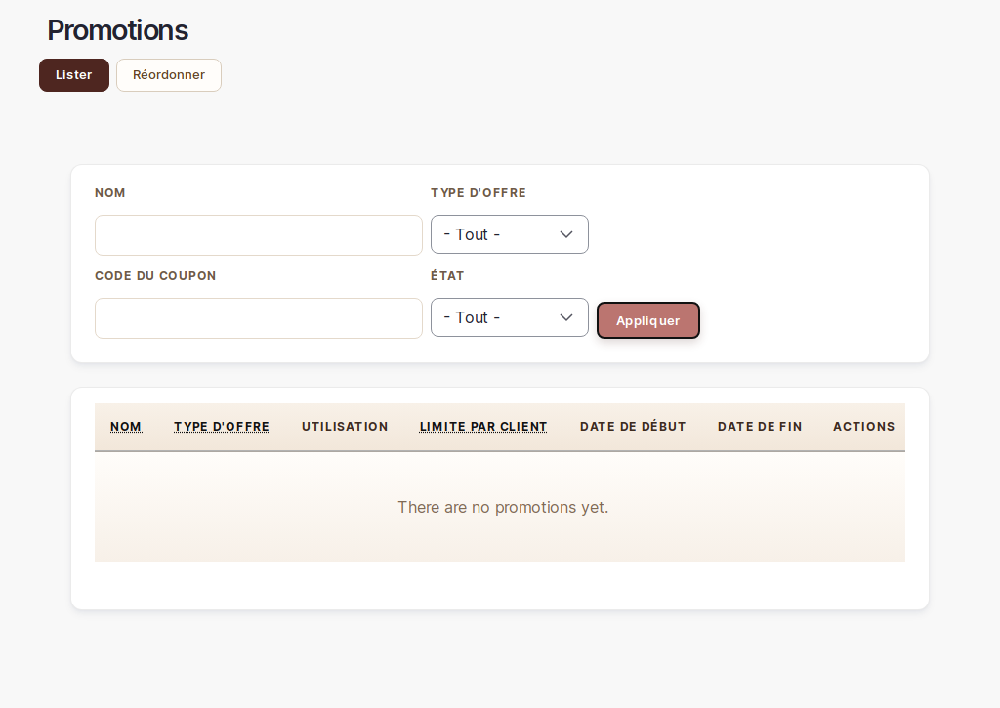

# Gestion des promotions

> 📍 **Accès** : Tableau de bord → **Promotions**
> **URL directe** : `/admin/commerce/promotions`

## Ce que vous pouvez faire ici

Vous pouvez créer des codes promo à partager avec vos clients, définir des réductions en montant fixe ou en pourcentage, et activer ou désactiver vos promotions à tout moment.

> 💡 **Astuce** : Pour les réductions automatiques sur les achats en quantité (ex. : -5% dès 3 articles), rendez-vous dans l'onglet **Promotions volume** de la page de configuration boutique (`/admin/boutique/configuration`). Les codes promo décrits ici sont réservés aux réductions manuelles avec un code à saisir.

---

## Voir les promotions actives

1. Aller sur `/admin/commerce/promotions`
2. La liste affiche toutes les promotions avec leur nom, leur statut (active ou inactive) et leurs conditions
3. Les promotions avec un code coupon ont une colonne **Coupons**

---

## Créer un code promo

### Créer une réduction en pourcentage

1. Aller sur `/admin/commerce/promotions`
2. Cliquer sur **Ajouter une promotion**
3. Remplir les champs :
   - **Nom** : nom interne pour vous identifier la promotion (ex. : "Promo printemps 2026")
   - **Code coupon** (facultatif) : saisir le code que vos clients devront entrer au moment du paiement (ex. : `PRINTEMPS10`)
4. Dans la section **Offres**, cliquer sur **Ajouter une offre** et choisir **Pourcentage de remise sur la commande**
5. Saisir le pourcentage (ex. : `10` pour 10 %)
6. Vérifier que la promotion est bien **Active** (case cochée en haut du formulaire)
7. Cliquer sur **Enregistrer**

### Créer une réduction en montant fixe

1. Suivre les étapes 1 à 3 ci-dessus
2. Dans la section **Offres**, choisir **Réduction fixe sur la commande**
3. Saisir le montant en euros (ex. : `5.00` pour 5 €)
4. Cliquer sur **Enregistrer**

> 💡 **Astuce** : Choisissez un code promo court, mémorisable et lié à l'occasion (ex. : `NOEL2026`, `MERCI10`). Évitez les codes trop longs ou compliqués à saisir sur mobile.

---

## Limiter une promotion à une période

1. Dans le formulaire de création ou de modification d'une promotion, descendre jusqu'à la section **Conditions**
2. Cliquer sur **Ajouter une condition** et choisir **Date de début** ou **Date de fin**
3. Saisir la date et l'heure souhaitées
4. Cliquer sur **Enregistrer**

---

## Désactiver une promotion

### Désactiver temporairement (sans supprimer)

1. Sur `/admin/commerce/promotions`, cliquer sur **Modifier** à côté de la promotion
2. Décocher la case **Active** en haut du formulaire
3. Cliquer sur **Enregistrer**

La promotion est désactivée mais reste dans la liste. Vous pouvez la réactiver à tout moment.

### Supprimer une promotion

> ⚠️ **Attention** : La suppression d'une promotion est **irréversible**. Si des clients ont déjà utilisé un code promo lié à cette promotion, l'historique de leurs commandes ne sera pas modifié, mais la promotion ne pourra pas être récupérée.

1. Sur `/admin/commerce/promotions`, cliquer sur **Supprimer** à côté de la promotion
2. Confirmer la suppression

---

## Vérifier qu'un code promo fonctionne

1. Ouvrir votre boutique dans un autre onglet de navigateur
2. Ajouter un produit au panier
3. Aller au paiement et saisir le code promo dans le champ prévu
4. Vérifier que la réduction s'applique bien avant de finaliser

> 💡 **Astuce** : Testez toujours votre code promo avant de le communiquer à vos clients. Un code mal configuré peut créer de la confusion.

---

*Documentation Atelier O Design — Promotions — v1.0*
