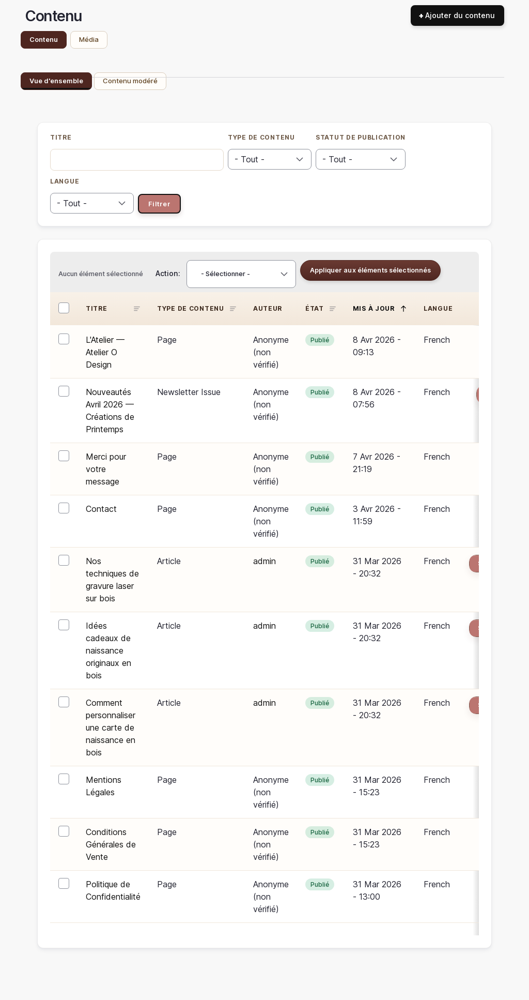

# Contenu éditorial — Articles, guides et pages

> 📍 **Accès** : Tableau de bord → **Articles**
> **URL directe** : `/admin/content`

## Ce que vous pouvez faire ici

Vous pouvez écrire et publier des articles de blog, créer des guides pratiques pour vos clients et modifier le contenu des pages fixes de votre site (CGV, mentions légales, etc.).

---

## Articles de blog

### Créer un nouvel article

1. Aller sur `/admin/content`
2. Cliquer sur **Ajouter un contenu**
3. Choisir **Article**
4. Remplir les champs :
   - **Titre** : le titre de l'article, visible sur la page et dans les résultats de recherche
   - **Corps** : le contenu principal de l'article (utilisez la barre d'outils pour mettre en forme : gras, titres, listes, liens)
   - **Image de couverture** : la photo qui illustre l'article dans la liste du blog
5. Dans la section **Informations de publication** (à droite ou en bas), vérifier que **Publié** est coché si l'article doit être visible immédiatement
6. Cliquer sur **Enregistrer**

> 💡 **Astuce** : Un bon article de blog répond à une question que se posent vos clients. Des idées de sujets : "Comment personnaliser un cadeau de naissance", "Quelles matières pour un hochet sécurisé", "Idées cadeaux pour un mariage".

### Modifier un article existant

1. Aller sur `/admin/content`
2. Trouver l'article dans la liste (vous pouvez filtrer par **Type de contenu** → Article)
3. Cliquer sur **Modifier** à droite de l'article
4. Effectuer vos modifications
5. Cliquer sur **Enregistrer**

### Dépublier un article (le masquer sans le supprimer)

1. Sur `/admin/content`, cliquer sur **Modifier** à côté de l'article
2. Décocher la case **Publié**
3. Cliquer sur **Enregistrer**

L'article disparaît du blog mais reste dans votre liste d'administration.

### Supprimer un article

> ⚠️ **Attention** : La suppression d'un article est **irréversible**. Le contenu sera définitivement perdu. Préférez la dépublication si vous souhaitez conserver la possibilité de le republier.

1. Sur `/admin/content`, cliquer sur **Supprimer** à droite de l'article
2. Confirmer la suppression

---

## Guides pratiques

Les guides pratiques fonctionnent comme les articles de blog mais sont présentés dans une section dédiée de votre site.

### Créer un nouveau guide

1. Aller sur `/admin/content`
2. Cliquer sur **Ajouter un contenu**
3. Choisir **Guide**
4. Remplir les champs **Titre**, **Corps** et **Image** de la même façon que pour un article
5. Cliquer sur **Enregistrer**

> 💡 **Astuce** : Des exemples de guides utiles pour vos clients : "Comment choisir la bonne taille pour un bijou prénom", "Guide des occasions pour offrir une pièce personnalisée".

### Modifier un guide existant

1. Sur `/admin/content`, filtrer par **Type de contenu** → Guide
2. Cliquer sur **Modifier** à côté du guide
3. Effectuer vos modifications et cliquer sur **Enregistrer**

---

## Pages fixes du site

Certaines pages de votre site ont un contenu fixe que vous pouvez modifier : les conditions générales de vente, les mentions légales et la politique de confidentialité.

> ⚠️ **Attention** : Ces pages ont une valeur juridique. Avant de modifier leur contenu, consultez votre conseiller juridique ou vérifiez que vos modifications sont conformes à la réglementation en vigueur.

| Page | URL sur le site | Comment y accéder |
|------|----------------|-------------------|
| Atelier | `/atelier` | Via `/admin/content` → chercher "Atelier" |
| Conditions Générales de Vente | `/cgv` | Via `/admin/content` → chercher "CGV" |
| Mentions légales | `/mentions-legales` | Via `/admin/content` → chercher "Mentions" |
| Politique de confidentialité | `/politique-confidentialite` | Via `/admin/content` → chercher "Confidentialité" |

### Modifier une page fixe

1. Aller sur `/admin/content`
2. Chercher la page par son titre dans le champ de recherche
3. Cliquer sur **Modifier**
4. Modifier le contenu dans le champ **Corps**
5. Cliquer sur **Enregistrer**

---

## Gérer les catégories d'articles (occasions de vie)

Vous pouvez ajouter ou modifier les catégories qui servent à organiser vos produits et articles par occasion (mariage, naissance, anniversaire…).

1. Aller sur `/admin/structure/taxonomy/manage/life_occasion/overview`
2. Cliquer sur **Ajouter un terme** pour créer une nouvelle occasion
3. Saisir le **Nom** de l'occasion
4. Cliquer sur **Enregistrer**

> 💡 **Astuce** : Ces catégories apparaissent dans les filtres de la boutique. Ajoutez-en de nouvelles au fil des saisons (ex. : "Fête des Mères", "Rentrée des classes").

---

*Documentation Atelier O Design — Contenu éditorial — v1.0*
