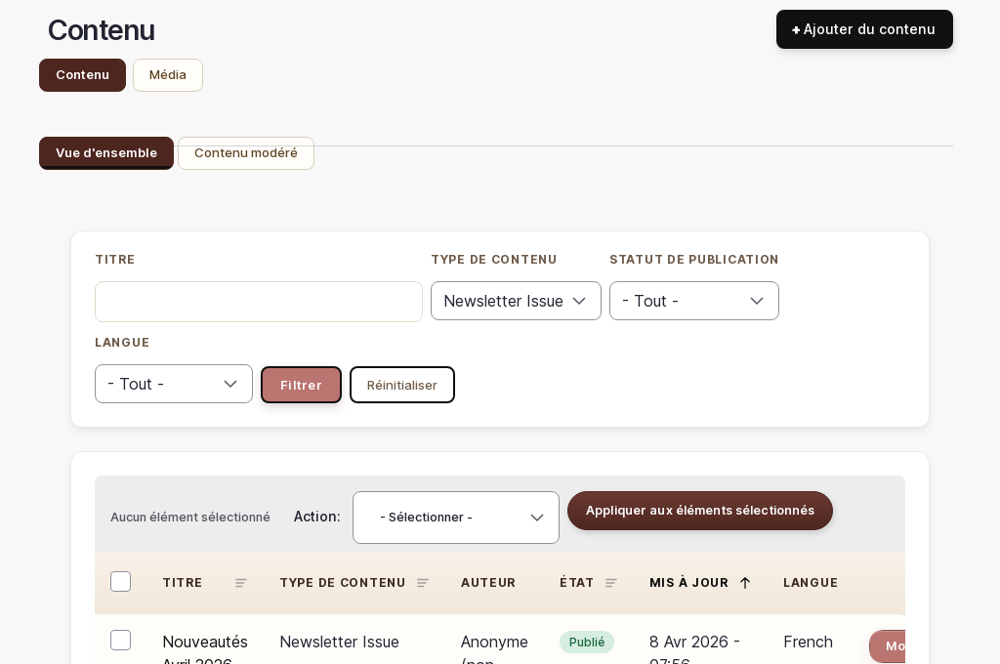

# Newsletter

> 📍 **Accès** : Tableau de bord → **Contenu** → **Newsletters**
> **URL directe** : `/admin/content/simplenews`

## Ce que vous pouvez faire ici

Vous pouvez créer et envoyer des newsletters à vos abonnés, planifier des envois à l'avance et consulter la liste de vos abonnées.

---

## Créer une newsletter

1. Aller sur `/admin/content/simplenews`
2. Cliquer sur **Ajouter une newsletter**
3. Remplir les champs :
   - **Titre** : le sujet de la newsletter (ce que vos abonnées voient dans leur boîte mail)
   - **Corps** : le contenu de votre message (utilisez la barre d'outils pour mettre en forme, ajouter des images et des liens)
4. Dans la section **Newsletter** (à droite), vérifier que la liste de diffusion sélectionnée est correcte
5. Ne pas encore envoyer — voir les étapes suivantes

> 💡 **Astuce** : Rédigez un objet (le titre) accrocheur mais honnête. Exemples : "Nouveautés de printemps 🌸", "Votre code promo anniversaire", "Découvrez nos cadeaux de naissance personnalisés".

---

## Envoyer une newsletter immédiatement

1. Après avoir créé ou modifié votre newsletter, cliquer sur **Envoyer**
2. Un message de confirmation affiche le nombre d'abonnées qui vont recevoir l'email
3. Confirmer l'envoi en cliquant sur **Envoyer** dans la fenêtre de confirmation

> ⚠️ **Attention** : L'envoi d'une newsletter est **immédiat et irréversible**. Une fois envoyée, vous ne pouvez pas la rappeler ni modifier le contenu pour les destinataires qui l'ont déjà reçu. Relisez attentivement votre message avant d'envoyer.

---

## Planifier un envoi

Si vous souhaitez qu'une newsletter parte à une date et une heure précises :

1. Créer votre newsletter (voir ci-dessus)
2. Dans la section **Newsletter**, cocher **Planifier l'envoi**
3. Saisir la date et l'heure d'envoi souhaitées
4. Cliquer sur **Enregistrer**

La newsletter sera envoyée automatiquement à l'heure programmée.

> 💡 **Astuce** : Les newsletters ont de meilleurs taux d'ouverture le mardi et jeudi matin entre 9h et 11h. Évitez les lundis et les vendredi après-midi.

---

## Voir la liste des abonnées

1. Aller sur `/admin/simplenews`
2. La liste affiche toutes les personnes inscrites à votre newsletter avec leur adresse email et leur statut (actif, désabonné)

> 💡 **Astuce** : Les personnes qui se désabonnent sont conservées dans la liste avec le statut "Désabonné" pour des raisons légales (traçabilité RGPD). Vous ne pouvez pas les supprimer directement.

---

## Gérer les abonnements

### Voir les détails d'un abonnement

1. Sur `/admin/simplenews`, cliquer sur l'adresse email d'un abonné
2. Vous voyez sa date d'inscription et son statut

### Ajouter manuellement un abonné

> ⚠️ **Attention** : Vous ne pouvez ajouter manuellement que des personnes qui vous ont **explicitement donné leur consentement** pour recevoir votre newsletter. Ajouter des adresses sans consentement est interdit par la réglementation RGPD.

1. Aller sur `/admin/simplenews`
2. Cliquer sur **Ajouter un abonné**
3. Saisir l'adresse email
4. Confirmer l'ajout

---

## Relire une newsletter déjà envoyée

1. Aller sur `/admin/content/simplenews`
2. Cliquer sur le titre de la newsletter envoyée
3. La page affiche le contenu tel qu'il a été envoyé ainsi que les différentes versions (révisions)

---

## Relances panier abandonné (automatique)

Le site envoie automatiquement des emails de relance quand un client quitte son panier sans finaliser sa commande.

Règles actuelles :

- 1er rappel après environ **2 heures** d'inactivité
- 2e rappel après environ **24 heures** (si la commande n'est toujours pas finalisée)
- Maximum : **2 relances** par panier

Vous n'avez rien à faire pour déclencher ces relances.

> 💡 Si le client termine sa commande, les relances s'arrêtent naturellement pour ce panier.

> ⚠️ Ces emails sont des emails transactionnels automatiques (pas des newsletters marketing).

---

*Documentation O'Design Création — Newsletter — v1.0*
