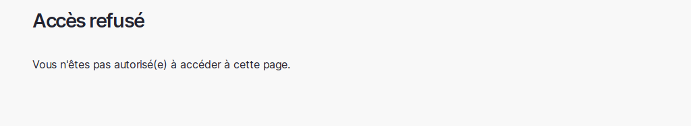

# Gestion des clients

> 📍 **Accès** : Tableau de bord → **Clients**
> **URL directe** : `/admin/people`

## Ce que vous pouvez faire ici

Vous pouvez rechercher un client par son nom ou son adresse email, consulter son profil et voir l'historique de ses commandes. Vous ne pouvez pas modifier les rôles ou les accès des utilisateurs — ces actions sont réservées à l'administrateur technique.

---

## Rechercher un client

1. Aller sur `/admin/people`
2. Dans le champ **Nom ou email**, saisir le nom ou l'adresse email du client recherché
3. Cliquer sur **Filtrer**
4. La liste affiche les comptes correspondants

> 💡 **Astuce** : Si vous cherchez un client à partir d'une commande, vous pouvez cliquer sur son nom directement dans la fiche de commande pour accéder à son profil.

---

## Voir le profil d'un client

1. Depuis la liste des clients (`/admin/people`), cliquer sur le nom du client
2. Le profil affiche :
   - Son adresse email
   - La date d'inscription
   - Son statut de compte (actif ou bloqué)

---

## Voir l'historique des commandes d'un client

### Depuis la fiche client

1. Ouvrir le profil du client (voir ci-dessus)
2. Cliquer sur l'onglet **Commandes** (si disponible dans son profil)
3. La liste affiche toutes les commandes passées par ce client

### Depuis la liste des commandes

1. Aller sur `/admin/commerce/orders`
2. Dans le filtre **Client**, saisir le nom ou l'email du client
3. Cliquer sur **Appliquer**
4. Toutes les commandes de ce client s'affichent

---

## Ce que vous ne pouvez pas faire

Certaines actions sur les comptes clients sont réservées à l'administrateur technique :

- **Modifier le mot de passe** d'un client
- **Attribuer ou retirer un rôle** (ex. : passer un compte en administrateur)
- **Supprimer un compte** client
- **Bloquer un compte** client

Si vous avez besoin d'effectuer l'une de ces actions, contactez votre prestataire technique.

> ⚠️ **Attention** : Ne tentez pas de modifier les accès ou les rôles des comptes, même si vous voyez des options dans certaines pages. Ces modifications peuvent avoir des conséquences importantes sur la sécurité de votre boutique.

---

## Cas fréquents

### Un client ne retrouve pas son mot de passe

Dirigez le client vers la page de connexion de votre boutique, où il peut cliquer sur **Mot de passe oublié ?** et recevoir un lien de réinitialisation par email. Vous n'avez pas à intervenir.

### Un client dit ne pas avoir reçu son email de confirmation de commande

1. Vérifier dans `/admin/commerce/orders` que la commande existe bien et que son statut est correct
2. Vérifier que l'adresse email du client dans la commande est correcte
3. Conseiller au client de vérifier ses spams
4. Si le problème persiste, contactez votre prestataire technique (le système d'envoi d'emails peut nécessiter une vérification)

### Un client souhaite modifier ou annuler sa commande

1. Retrouver la commande dans `/admin/commerce/orders`
2. Consulter la fiche de commande pour voir son statut actuel
3. Si la commande n'est pas encore en fabrication, vous pouvez changer son statut vers **Annulée** (voir la documentation sur les commandes)
4. Contactez le client par email pour confirmer l'annulation

---

*Documentation Atelier O Design — Clients — v1.0*
