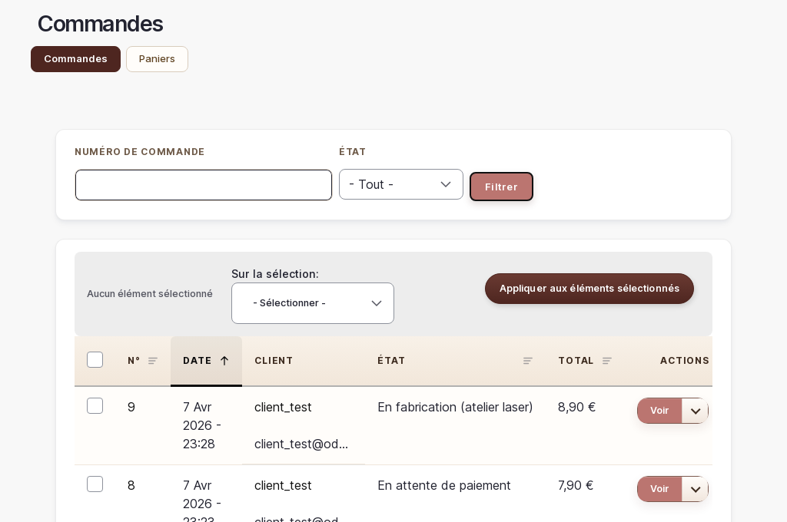

# Gestion des clients

> ℹ️ **Accès limité** : Il n'existe pas de page "liste des clients" accessible au gestionnaire. La gestion de la relation client se fait principalement **via les commandes** (`/admin/commerce/orders`), qui contiennent le nom et l'email de chaque client.

## Ce que vous pouvez faire

Depuis la liste des commandes, vous pouvez retrouver un client, consulter ses coordonnées et voir l'historique de ses achats. Vous ne pouvez pas modifier les comptes utilisateurs — ces actions sont réservées à l'administrateur technique.

---

## Retrouver un client via ses commandes

1. Aller sur `/admin/commerce/orders`
2. Les colonnes **CLIENT** et **EMAIL** permettent d'identifier l'acheteur
3. Cliquer sur **Voir** à droite d'une commande pour accéder à sa fiche complète

> 💡 **Astuce** : La fiche de commande affiche l'adresse de livraison, l'email de contact et le détail des articles commandés.

---

## Ce que vous ne pouvez pas faire

Certaines actions sur les comptes clients sont réservées à l'administrateur technique :

- **Modifier le mot de passe** d'un client
- **Attribuer ou retirer un rôle** (ex. : passer un compte en administrateur)
- **Supprimer un compte** client
- **Bloquer un compte** client

Si vous avez besoin d'effectuer l'une de ces actions, contactez votre prestataire technique.

> ⚠️ **Attention** : Ne tentez pas de modifier les accès ou les rôles des comptes, même si vous voyez des options dans certaines pages. Ces modifications peuvent avoir des conséquences importantes sur la sécurité de votre boutique.

---

## Cas fréquents

### Un client ne retrouve pas son mot de passe

Dirigez le client vers la page de connexion de votre boutique, où il peut cliquer sur **Mot de passe oublié ?** et recevoir un lien de réinitialisation par email. Vous n'avez pas à intervenir.

### Un client dit ne pas avoir reçu son email de confirmation de commande

1. Vérifier dans `/admin/commerce/orders` que la commande existe bien et que son statut est correct
2. Vérifier que l'adresse email du client dans la commande est correcte
3. Conseiller au client de vérifier ses spams
4. Si le problème persiste, contactez votre prestataire technique (le système d'envoi d'emails peut nécessiter une vérification)

### Un client souhaite modifier ou annuler sa commande

1. Retrouver la commande dans `/admin/commerce/orders`
2. Consulter la fiche de commande pour voir son statut actuel
3. Si la commande n'est pas encore en fabrication, vous pouvez changer son statut vers **Annulée** (voir la documentation sur les commandes)
4. Contactez le client par email pour confirmer l'annulation

---

*Documentation Atelier O Design — Clients — v1.0*
