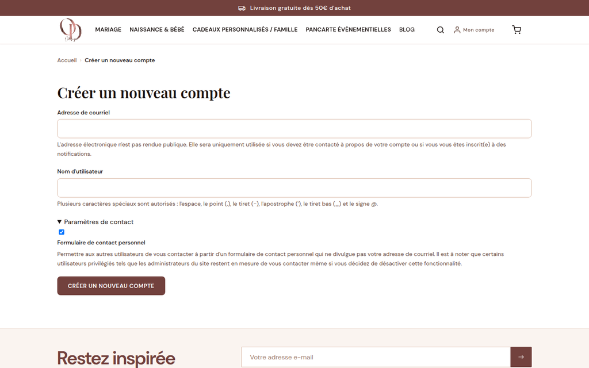
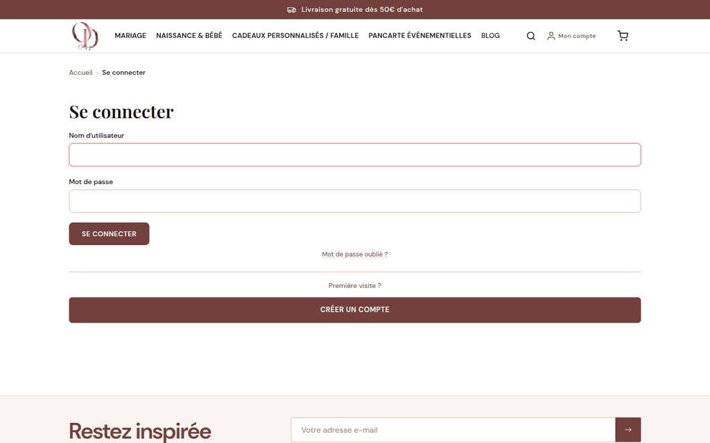
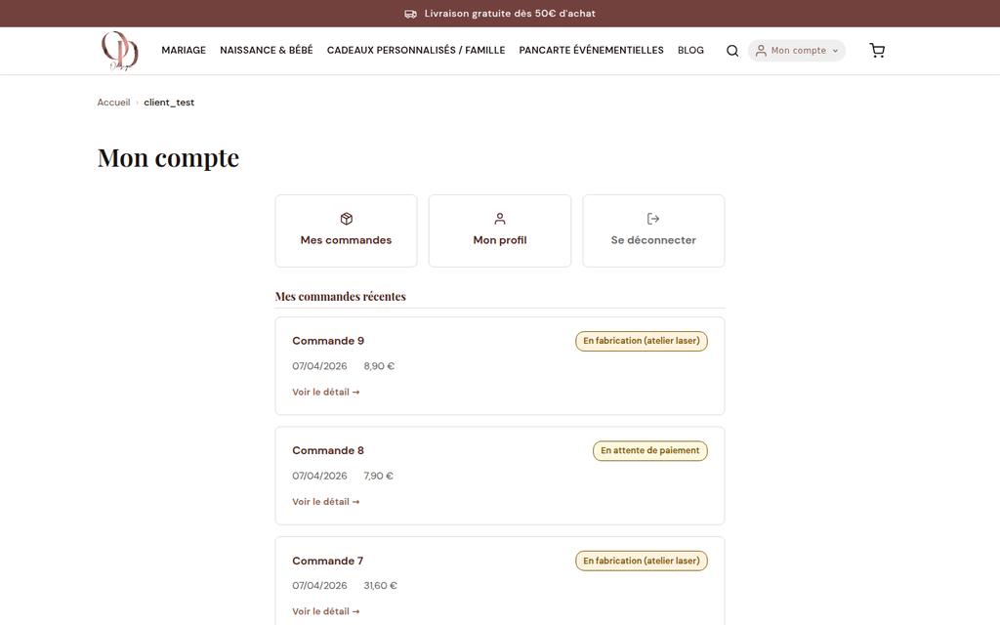
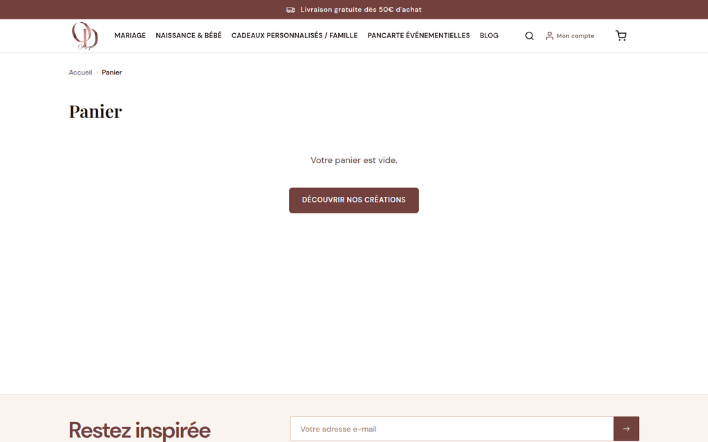
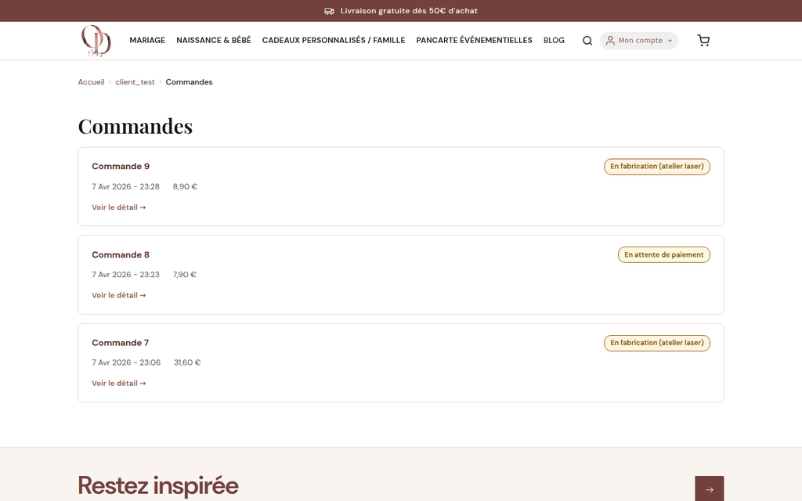

# L'espace client — Ce que voient vos clients

> 📍 **Cette section n'est pas une interface d'administration.**
> Elle vous décrit ce que **vos clients voient** sur le site, afin que vous puissiez répondre à leurs questions et les aider en cas de problème.

---

## Ce que vous pouvez faire ici

Comprendre le parcours de vos clients (connexion, commande, suivi) pour répondre à leurs questions fréquentes sans avoir besoin d'assistance technique.

---

## Le compte client

### Créer un compte

Les clients peuvent créer un compte depuis le bouton **Mon compte** en haut à droite du site (qui donne accès à la fois à la connexion et à la création de compte), depuis la page `/user/register` directement, ou lors du passage de commande. Ils reçoivent un **email de confirmation** avec un lien d'activation.

> 💡 **Si un client dit qu'il n'a pas reçu l'email** : demandez-lui de vérifier ses spams. Si le problème persiste, vous pouvez vérifier son adresse email dans [Clients](07-clients.md).

### Se connecter

Les clients se connectent sur `/user/login` avec leur email et mot de passe.

**Mot de passe oublié** : un lien "Mot de passe oublié" est disponible sur la page de connexion. Le client reçoit un email avec un lien de réinitialisation valable 24 heures.

> 💡 **Si un client ne reçoit pas l'email de réinitialisation** : vérifiez que son adresse email est correcte dans [Clients](07-clients.md) et que les emails de votre boutique sont bien configurés dans [Configuration boutique — onglet Emails](01-configuration-boutique.md).

### Modifier son profil

Le client peut modifier ses informations (adresse, mot de passe) depuis son espace personnel sur `/user/{son-identifiant}/edit`.

---

## Le parcours de commande

### Étape 1 — Ajouter au panier

Le client clique sur **Ajouter au panier** sur une fiche produit. Le compteur du panier (en haut à droite) se met à jour.

### Étape 2 — Le panier (`/cart`)

Le client voit la liste de ses articles, peut modifier les quantités ou supprimer un article, puis clique sur **Passer la commande**.

### Étape 3 — Le tunnel de commande (`/checkout`)

Le client saisit :
1. Son **adresse de livraison**
2. Ses **coordonnées de facturation** (si différentes)
3. Un **code promo** s'il en a un
4. Ses **informations de paiement** (carte bancaire via Stripe)

> ⚠️ **Le paiement est sécurisé par Stripe** — vous ne voyez jamais les numéros de carte de vos clients. Stripe gère entièrement la sécurité des paiements.

### Étape 4 — Confirmation (`/merci`)

Après le paiement, le client arrive sur la page de confirmation. Il reçoit simultanément un **email de confirmation de commande** à l'adresse qu'il a renseignée.

> 💡 **Si un client dit ne pas avoir reçu la confirmation** : vérifiez dans [Commandes](02-commandes.md) que la commande est bien enregistrée avec le statut "Payée / En attente de traitement". Si oui, le problème vient des emails (spams, adresse mal saisie).

---

## Les emails automatiques reçus par les clients

Votre boutique envoie automatiquement ces emails :

| Déclencheur | Email envoyé |
|---|---|
| Commande payée | Confirmation de commande avec le récapitulatif |
| Commande expédiée | Notification d'expédition (selon configuration) |
| Inscription newsletter | Email de bienvenue + confirmation RGPD |

> 💡 **Pour tester que les emails partent bien** : utilisez la fonction "Tester l'envoi d'email" dans [Configuration boutique — onglet Emails](01-configuration-boutique.md).

---

## Questions fréquentes de vos clients

### "Je ne retrouve pas ma commande dans mon espace client"

1. Demandez au client s'il est bien **connecté** à son compte (pas en tant qu'invité)
2. Vérifiez dans [Commandes](02-commandes.md) que la commande existe avec son email
3. Si la commande existe mais n'est pas visible dans son compte : il a peut-être commandé **sans créer de compte** (mode invité)

### "Je veux modifier mon adresse de livraison après avoir passé commande"

Il n'est pas possible de modifier automatiquement l'adresse après paiement. Vous pouvez :
1. Contacter votre prestataire technique pour une modification manuelle
2. Annuler la commande et demander au client de repasser commande avec la bonne adresse

> ⚠️ **L'annulation d'une commande ne déclenche pas automatiquement un remboursement.** Le remboursement doit être fait manuellement depuis votre interface Stripe (stripe.com).

### "Je veux annuler ma commande"

1. Aller dans [Commandes](02-commandes.md) et retrouver la commande du client
2. Changer le statut à **Annulée**
3. Effectuer le remboursement manuellement depuis votre tableau de bord Stripe si le paiement a déjà été prélevé
4. Informer le client par email

### "Je n'arrive pas à appliquer mon code promo"

Vérifications possibles :
- Le code est-il **actif** ? Voir [Promotions](04-promotions.md)
- Le code a-t-il une **date d'expiration** dépassée ?
- Y a-t-il un **nombre d'utilisations maximum** déjà atteint ?
- La commande remplit-elle les **conditions** de la promotion (montant minimum, produits ciblés) ?

### "Je veux une facture"

Les factures sont disponibles dans [Commandes](02-commandes.md) — section "Accéder à la facture d'une commande". Vous pouvez imprimer ou envoyer la facture au client.

---

## Ce que vous ne pouvez pas faire

| Action | Pourquoi |
|---|---|
| Modifier le mot de passe d'un client | Pour des raisons de sécurité — le client doit utiliser "Mot de passe oublié" |
| Rembourser directement depuis Drupal | Les remboursements se font depuis votre tableau de bord Stripe |
| Voir les numéros de carte bancaire des clients | Stripe ne les transmet jamais — c'est une protection légale |
| Modifier une commande après paiement | Annulation + nouvelle commande est la procédure standard |

---

*Documentation O'Design Création — Espace client — v1.0*
