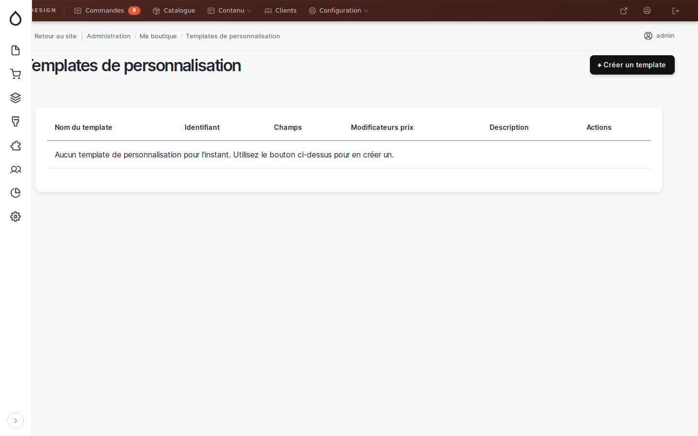
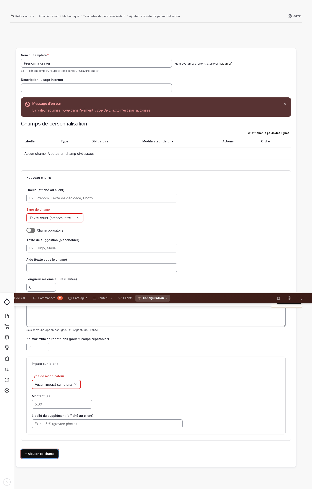
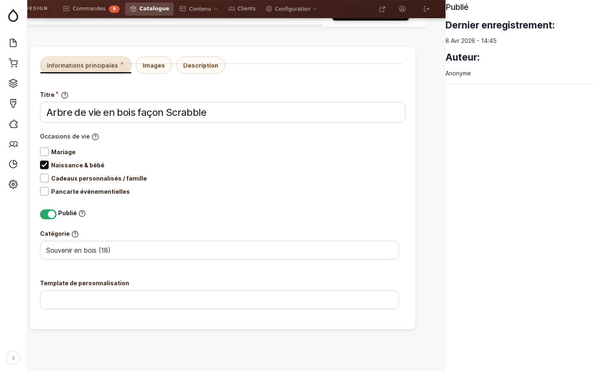
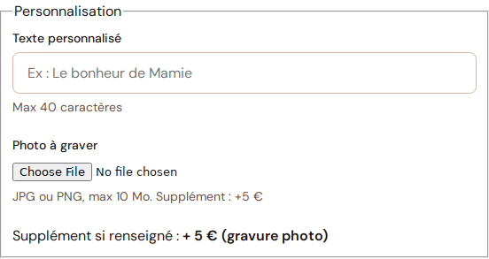
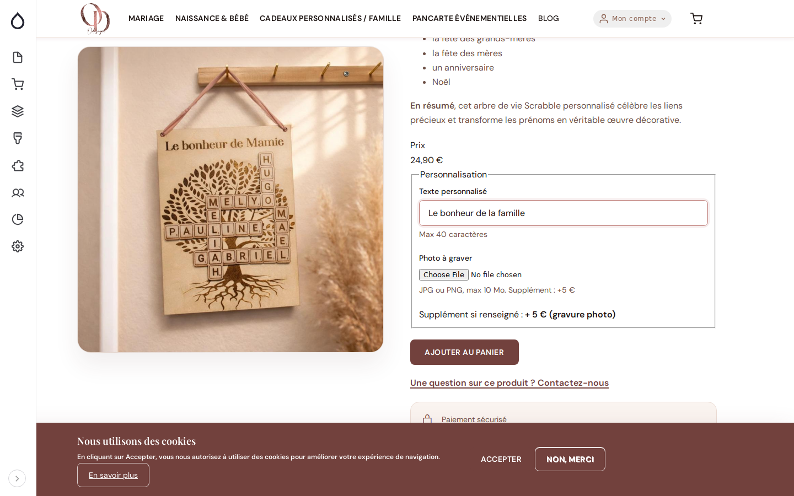
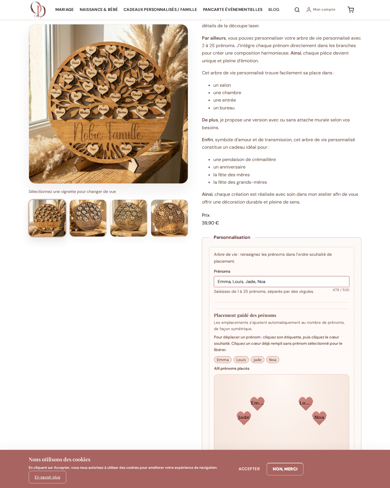

# Personnalisation des produits

> 📍 **Accès** : Tableau de bord → **Configuration** → **Personnalisation produits**
> **URL directe** : `/admin/boutique/personnalisation/templates`

Cette fonctionnalité vous permet de définir des champs de personnalisation (prénom, texte, photo…) que vos clients rempliront lors de leur commande. Chaque champ peut optionnellement augmenter le prix du produit.

---

## Comment ça fonctionne

Le principe est en deux étapes :

1. **Créer un modèle de personnalisation** — vous définissez les champs (ex : "Prénom à graver", "Photo à joindre") une seule fois.
2. **Associer ce modèle à un produit** — le formulaire de personnalisation apparaît automatiquement sur la fiche produit côté boutique.

---

## Gérer les modèles de personnalisation

### Voir la liste de vos modèles

Aller sur `/admin/boutique/personnalisation/templates`.

La liste affiche pour chaque modèle : son nom, son identifiant système, le nombre de champs qu'il contient, et s'il comporte des suppléments de prix.

---

### Créer un nouveau modèle

1. Cliquer sur **+ Créer un modèle** en haut à droite
2. Renseigner le **Nom du modèle** (ex : "Prénom simple", "Gravure photo", "Support naissance")
3. L'**identifiant système** se génère automatiquement — vous pouvez le modifier si besoin
4. Ajouter une description interne (facultatif, pour vous repérer si vous avez plusieurs modèles)
5. Ajouter vos champs de personnalisation (voir section suivante)
6. Cliquer sur **Enregistrer**

---

### Ajouter un champ de personnalisation

Dans le formulaire de création ou d'édition d'un modèle, la section **Champs de personnalisation** vous permet de composer le formulaire que verront vos clients.

Pour chaque champ, vous définissez :

| Paramètre | Description |
|---|---|
| **Libellé** | Le nom du champ affiché au client (ex : "Prénom à graver") |
| **Type de champ** | Le type de saisie (voir tableau ci-dessous) |
| **Obligatoire** | Si le client doit obligatoirement remplir ce champ |
| **Texte de suggestion** | Le placeholder affiché dans le champ vide (ex : "Ex : Hugo, Marie…") |
| **Aide** | Un texte d'aide affiché sous le champ |
| **Longueur maximale** | Pour les champs texte (0 = illimitée) |

#### Types de champs disponibles

| Type | Usage typique |
|---|---|
| **Texte court** | Prénom, titre, texte court |
| **Texte long** | Dédicace, message, plusieurs prénoms |
| **Nombre** | Quantité, âge |
| **Date** | Date de naissance, date d'événement |
| **Liste déroulante** | Choix parmi des options fixes |
| **Boutons radio** | Choix exclusif parmi 2-4 options |
| **Cases à cocher** | Sélection multiple |
| **Envoi de fichier** | Photo, logo (JPG/PNG) |
| **Groupe répétable** | Plusieurs entrées identiques (ex : plusieurs prénoms) |

---

### Ajouter un supplément de prix

Pour qu'un champ entraîne un supplément, développer la section **Impact sur le prix** dans la définition du champ :

- **Montant fixe** : le supplément s'ajoute une seule fois, quel que soit le contenu (ex : +5 € pour une gravure photo)
- **Montant par unité** : le supplément se multiplie selon la quantité saisie (ex : +2 € par prénom, si le client en saisit 3 → +6 €)

Renseigner également le **libellé du supplément** qui sera affiché au client (ex : "+ 5 € (gravure photo)").

---

## Associer un modèle à un produit

Une fois votre modèle créé, vous devez l'associer aux produits concernés :

1. Aller sur `/admin/commerce/products`
2. Cliquer sur **Modifier** à côté du produit
3. Dans l'onglet **Informations principales**, trouver le champ **Modèle de personnalisation**
4. Saisir le nom de votre modèle et le sélectionner dans la liste
5. Cliquer sur **Enregistrer**

> 💡 **Astuce** : Un modèle peut être réutilisé sur plusieurs produits. Par exemple, si vous avez 10 produits avec un simple champ "Prénom", créez un seul modèle "Prénom simple" et associez-le à tous ces produits.

---

## Ce que voit le client

Une fois le modèle associé, la section **Personnalisation** apparaît automatiquement sur la fiche produit, juste au-dessus du bouton "Ajouter au panier".

Le client voit :
- Chaque champ avec son libellé, son aide et son placeholder
- Les suppléments de prix indiqués en temps réel
- Le récapitulatif du supplément total avant validation

Les informations saisies sont transmises avec la commande et visibles dans le backoffice commandes.

### Cas particulier : produit "Arbre de vie"

Pour l'article **Arbre de vie en bois personnalisé**, l'interface client est spécialisée :

- un seul champ **Prénoms** est utilisé (jusqu'à 25 prénoms, séparés par des virgules) ;
- la zone de placement affiche des **cœurs** positionnés automatiquement de façon symétrique ;
- la taille d'affichage du prénom dans chaque cœur s'adapte automatiquement à la longueur du prénom ;
- l'option **attache murale** reste visible à côté du bloc.

#### Déplacer les prénoms sur les cœurs

Le client peut ajuster les positions avant d'ajouter au panier :

1. Cliquer sur l'étiquette d'un prénom (dans les pastilles au-dessus de la zone).
2. Cliquer sur le cœur de destination.
3. Pour libérer un cœur : cliquer sur un cœur déjà rempli sans prénom sélectionné.

> ✅ Le plan `slot -> prénom` est enregistré avec la ligne panier et reste disponible pour l'atelier.

### Pertinence pour la gestionnaire

- `pertinent` : **oui** (information de contrôle)
- Impact : moins d'erreurs de saisie côté client et meilleure lisibilité des placements pour la production atelier.
- Action recommandée : vérifier périodiquement le comportement sur la fiche `Arbre de vie en bois personnalisé` (lisibilité des cœurs + consigne de déplacement).

---

## Modifier ou supprimer un modèle

- **Modifier** : depuis la liste des modèles, cliquer sur **Modifier** à droite du modèle
- **Supprimer** : cliquer sur **Supprimer** — attention, si le modèle est associé à des produits, ceux-ci n'afficheront plus le formulaire de personnalisation

> ⚠️ **Attention** : Modifier un modèle affecte immédiatement tous les produits qui l'utilisent.
