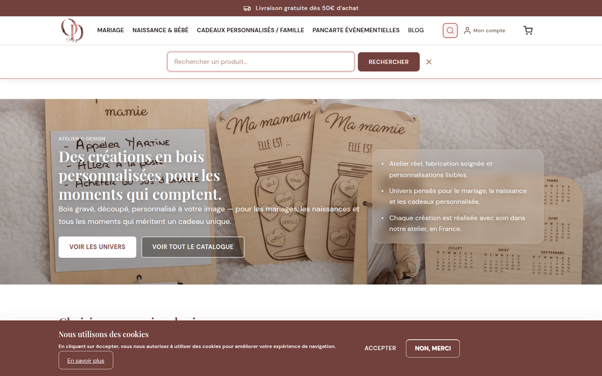
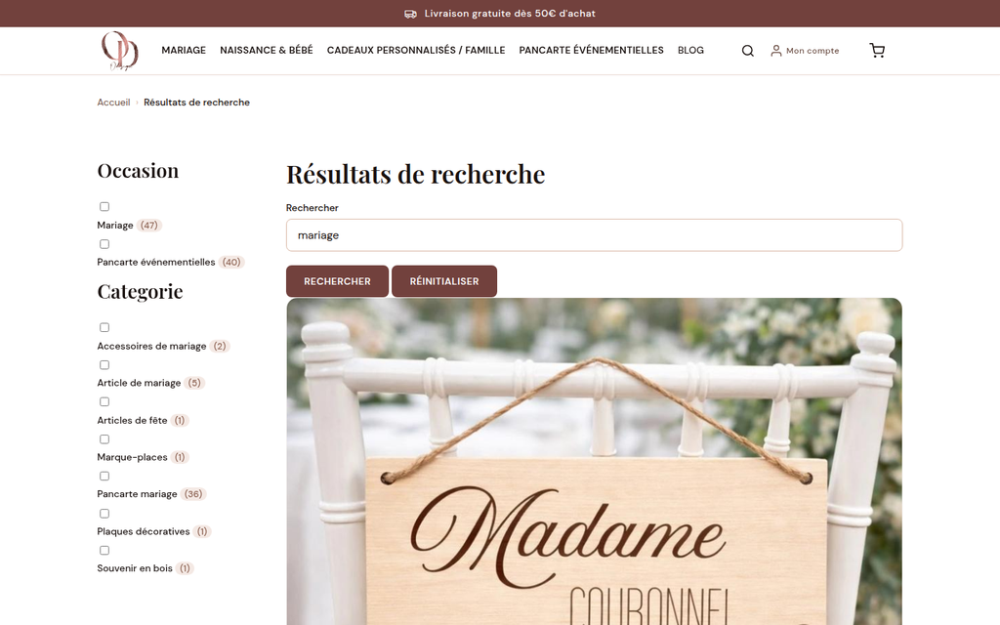
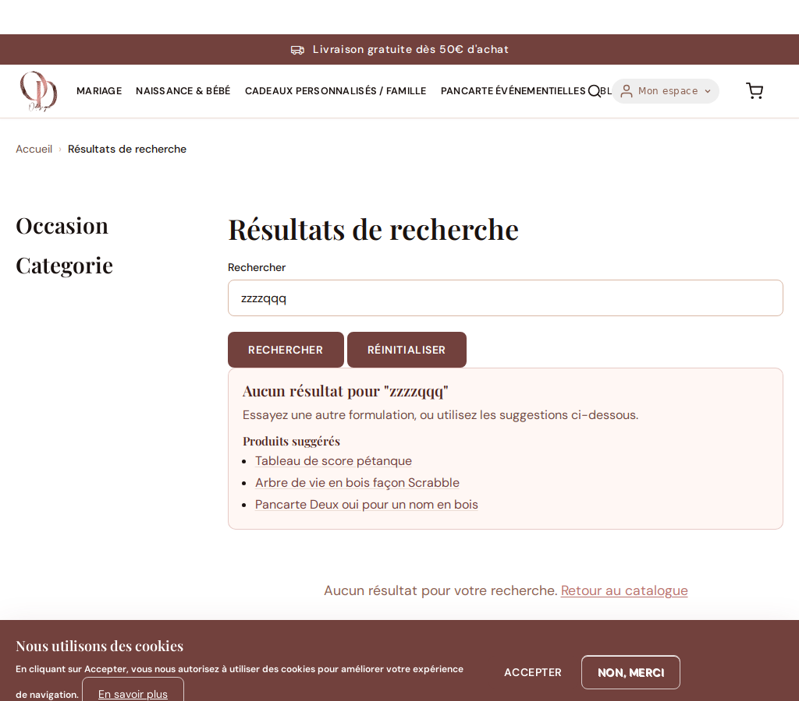

# Recherche produits — Guide gestionnaire

> 📍 Ce guide explique comment la recherche fonctionne pour les visiteurs du site
> et comment le gestionnaire peut l'administrer.

---

## Vue d'ensemble

Le site intègre un moteur de recherche produits accessible depuis le header
(icône loupe) et disponible à l'adresse `/recherche`.

### Ce que voit le client

1. **Icône loupe** dans le header → ouvre un panneau de saisie
2. Saisie d'un terme → redirection vers `/recherche?keys=TERME`
3. Résultats en grille (même présentation que le catalogue)
4. **Facettes** dans la colonne gauche pour affiner par Occasion ou Catégorie
5. Pagination : 12 résultats par page

### URL de recherche typiques

| Action | URL |
|---|---|
| Recherche libre | `/recherche?keys=bois` |
| Filtrer par occasion | `/recherche?keys=bois&f[0]=occasion:Mariage` |
| Filtrer par catégorie | `/recherche?keys=bois&f[0]=categorie:Mariage` |
| Aucun terme (tous les produits) | `/recherche` |

---

## Fonctionnement technique

La recherche utilise le module **Search API** avec un index SQLite (base Drupal).
L'index `products` couvre les champs :

- Titre du produit
- Description (body)
- Occasions de vie (`field_life_occasion`)
- Catégorie (`field_category`)
- Statut (seuls les produits **publiés** remontent)

### Autocomplétion

Le module `search_api_autocomplete` propose des suggestions dès 2 caractères
(maximum 6 suggestions), basées sur les titres et descriptions des produits.

---

## Merchandising de recherche

La recherche inclut désormais un niveau de merchandising B2C pour limiter les
sorties sans achat.

### 1. Synonymes métier (FR)

Un dictionnaire interne couvre les variantes les plus fréquentes, par exemple :

- `panneau` / `affiche` → `pancarte`
- `bébé` / `newborn` → `naissance`
- `sur mesure` / `custom` → `personnalisé`

Quand une recherche ne remonte rien, ces synonymes sont proposés sous forme de
liens rapides "Recherches proches".

### 2. Expérience "zéro résultat" enrichie

Si aucune fiche produit ne correspond, la page affiche un bloc d'aide avec :

- des recherches proches (synonymes)
- des catégories à explorer
- des produits suggérés

Objectif : éviter une impasse pour le client et faciliter la reprise du parcours.

### 3. Journal des requêtes sans résultat

Les requêtes sans résultat sont historisées dans la table :

- `odesign_search_no_result_log`

Chaque entrée agrège :

- la requête normalisée
- le nombre d'occurrences (`hit_count`)
- la première et la dernière date d'observation

Requête SQL utile pour la revue mensuelle :

```sql
SELECT query_raw, query_normalized, hit_count, last_seen
FROM odesign_search_no_result_log
ORDER BY hit_count DESC, last_seen DESC
LIMIT 30;
```

---

## Réindexer manuellement

Si des produits récemment créés ou modifiés ne remontent pas dans les résultats,
il faut forcer la réindexation.

### Via Drush (recommandé)

```bash
# En local avec DDEV
ddev exec drush search-api:index

# Si des produits semblent manquants malgré la réindexation
ddev exec drush search-api:reset-tracker products
ddev exec drush search-api:index
```

### Via l'interface admin

1. Aller dans **Admin → Recherche → Serveurs de recherche**
2. Cliquer sur `default_db`
3. Dans l'onglet **Index**, cliquer sur **Réindexer**

> 💡 **Note :** L'index est aussi mis à jour automatiquement lors de la prochaine
> exécution des tâches cron (toutes les heures en production Pantheon).

---

## Ajouter un nouveau champ à la recherche

Si vous souhaitez que de nouveaux champs produit soient recherchables :

1. Aller dans **Admin → Recherche → Index Products**
2. Onglet **Champs** → Ajouter le champ souhaité
3. Sauvegarder, puis réindexer (voir section ci-dessus)
4. Exporter la configuration : `ddev exec drush config:export -y`
5. Committer les fichiers `config/sync/search_api.index.products.yml` modifiés

---

## Gérer les facettes

Les facettes permettent aux clients de filtrer les résultats.
Deux facettes sont actives par défaut :

| Facette | Champ | URL alias |
|---|---|---|
| Occasion | `field_life_occasion` (libellé) | `occasion` |
| Catégorie | `field_category` (libellé) | `categorie` |

Pour modifier ou ajouter une facette :
1. Aller dans **Admin → Configuration → Recherche → Facettes**
2. Modifier la facette souhaitée ou en créer une nouvelle
3. Associer la nouvelle facette à la source `search_api:views_page__recherche_produits__page_1`

---

## Visuels de référence



*Cliquer sur l'icône loupe dans le header ouvre le panneau de saisie.*



*La page `/recherche` affiche les résultats en grille avec les facettes de filtrage à gauche.*



*Quand aucun produit ne correspond, un bloc propose des alternatives utiles.*

---

## Dépannage

| Symptôme | Cause probable | Solution |
|---|---|---|
| Un produit ne remonte pas | Produit non indexé | `drush search-api:index` |
| Les facettes n'apparaissent pas | Cache Drupal | `drush cr` |
| L'autocomplétion ne fonctionne pas | Module désactivé | Vérifier `drush pm:list` pour `search_api_autocomplete` |
| Résultats vides sur tous les termes | Index vide | `drush search-api:reset-tracker && drush search-api:index` |
