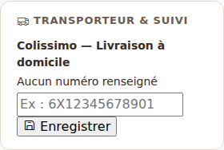
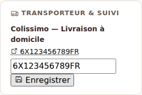
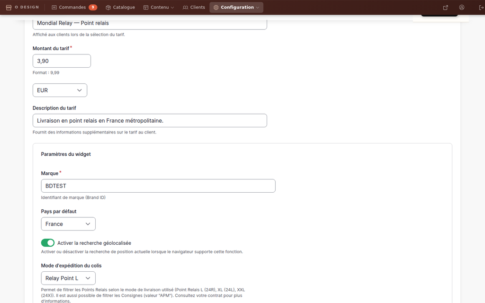
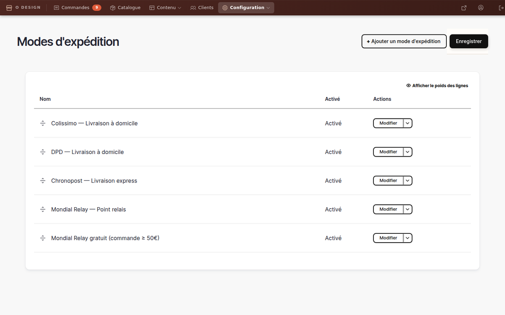
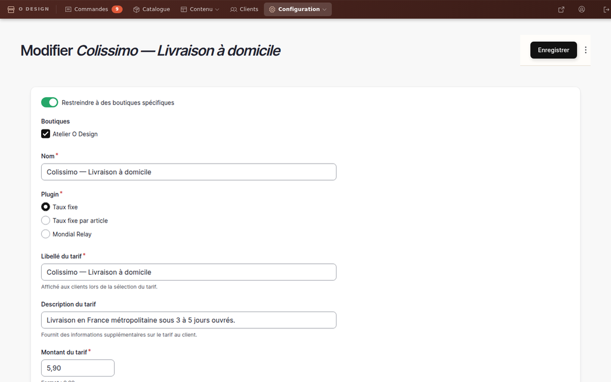

# 11 — Expédition et transporteurs

> Guide gestionnaire boutique · Atelier O Design

---

## État des fonctionnalités par transporteur

| Transporteur | Sélection au checkout | Widget point relais | Génération d'étiquette |
|---|---|---|---|
| **Colissimo** | ✅ Disponible | — | ⏳ Phase future (API Okapi) |
| **DPD** | ✅ Disponible | — | ⏳ Phase future |
| **Chronopost** | ✅ Disponible | — | ⏳ Phase future |
| **Mondial Relay** | ✅ Disponible | ✅ Widget actif (BDTEST → prod) | ⏳ Phase future |

> **Phases :** La sélection du transporteur et la saisie du numéro de suivi sont disponibles dès maintenant. La génération automatique d'étiquettes d'expédition nécessite une intégration API par transporteur — prévu en V2.

---

## Les transporteurs disponibles au checkout

| Transporteur | Tarif | Réseau |
|---|---|---|
| **Colissimo** — Livraison à domicile | 5,90 € | La Poste, 3–5 jours ouvrés |
| **DPD** — Livraison à domicile | 5,90 € | DPD, 2–4 jours ouvrés |
| **Chronopost** — Livraison express | 7,90 € | Chronopost, J+1 avant 13h |
| **Mondial Relay** — Point relais | 3,90 € | Réseau Mondial Relay |
| **Mondial Relay gratuit** *(≥ 50€)* | 0,00 € | Réseau Mondial Relay |

> **Note :** Le Mondial Relay gratuit n'apparaît dans la liste du checkout que si le montant du panier est supérieur ou égal à 50 €.

---

## Voir quel transporteur a été sélectionné

1. Allez dans **Commandes** via la navigation boutique
2. Cliquez sur une commande pour ouvrir son détail
3. Dans le bloc **Transporteur & suivi** (colonne de gauche), le transporteur sélectionné par le client s'affiche en gras

> **Mondial Relay :** l'adresse du point relais choisi par le client est visible dans le bloc **Adresse de livraison** de la même fiche commande.



---

## Renseigner le numéro de suivi

1. Ouvrez la commande concernée
2. Dans le bloc **Transporteur & suivi**, saisissez le numéro dans le champ prévu
3. Cliquez sur **Enregistrer**

Le numéro est immédiatement enregistré. Si le transporteur est reconnu (Colissimo, DPD, Chronopost ou Mondial Relay), un **lien cliquable vers le site de suivi** apparaît automatiquement.



### Liens de suivi générés automatiquement

| Transporteur | URL de suivi |
|---|---|
| Colissimo | `https://www.laposte.fr/outils/suivre-vos-envois?code={numéro}` |
| DPD | `https://www.dpd.fr/trace/{numéro}` |
| Chronopost | `https://www.chronopost.fr/tracking-no-cms/suivi-page?listeNumerosLt={numéro}` |
| Mondial Relay | `https://www.mondialrelay.fr/suivi-de-colis/?numColis={numéro}` |

> Le lien s'ouvre dans un nouvel onglet. Il suffit de cliquer sur le numéro de suivi affiché dans la fiche commande.

---

## Configurer le widget point relais Mondial Relay

> **Backoffice** : Configuration → Transporteurs & tarifs → "Mondial Relay — Point relais" → Modifier

Le widget de sélection de point relais est actif avec un **Brand ID de test** (`BDTEST`). Pour la mise en production, il faut le remplacer par votre Brand ID réel.

### Obtenir votre Brand ID de production

1. Connectez-vous à votre espace pro Mondial Relay : [connect.mondialrelay.com](https://connect.mondialrelay.com/)
2. Accédez à vos paramètres API (section **Api settings** ou équivalent selon votre type de compte)
3. Générez ou récupérez vos identifiants API
4. Notez votre **Brand ID** (code alphanumérique fourni par Mondial Relay, ex : `12345`)

### Saisir le Brand ID dans le backoffice

1. Dans la navigation boutique, ouvrez **Configuration** → **Transporteurs & tarifs**
2. Cliquez sur **Modifier** à côté de "Mondial Relay — Point relais"
3. Dans le champ **Marque**, remplacez `BDTEST` par votre Brand ID réel
4. Répétez pour "Mondial Relay gratuit (commande ≥ 50€)"
5. Cliquez sur **Enregistrer**



> ⚠️ Tant que le champ **Marque** contient `BDTEST`, le widget est en mode sandbox : les points relais affichés sont fictifs. Ne pas laisser `BDTEST` en production.

---

## Configurer les tarifs d'un transporteur

> **Backoffice** : Configuration → Transporteurs & tarifs

Tous les transporteurs sont modifiables depuis le backoffice sans intervention technique.



1. Cliquez sur **Modifier** à côté du transporteur
2. Modifiez le montant dans le champ **Montant du tarif**
3. Cliquez sur **Enregistrer**



---

## Livraison Mondial Relay gratuite dès 50 €

- La méthode **"Mondial Relay gratuit (commande ≥ 50€)"** est proposée automatiquement au checkout uniquement si le panier atteint 50 € ou plus.
- Le client qui la sélectionne ne paie aucun frais de port.
- Les autres transporteurs (Colissimo, DPD, Chronopost) conservent leur tarif même si le panier dépasse 50 €.
- Il n'y a pas de promotion "automatique" qui s'appliquerait à tous les transporteurs — la gratuité est liée au **choix explicite de Mondial Relay**.

---

## En cas de problème

Si les méthodes d'expédition n'apparaissent pas au checkout, contactez votre prestataire technique pour relancer le script de configuration :

```bash
ddev drush php-script scripts/seed-shipping-methods.php
```

Ce script est idempotent : il peut être relancé sans créer de doublons.

> **Note :** Cette commande s'exécute en environnement de développement local (DDEV). Sur Pantheon, le prestataire utilisera l'équivalent via Terminus.
