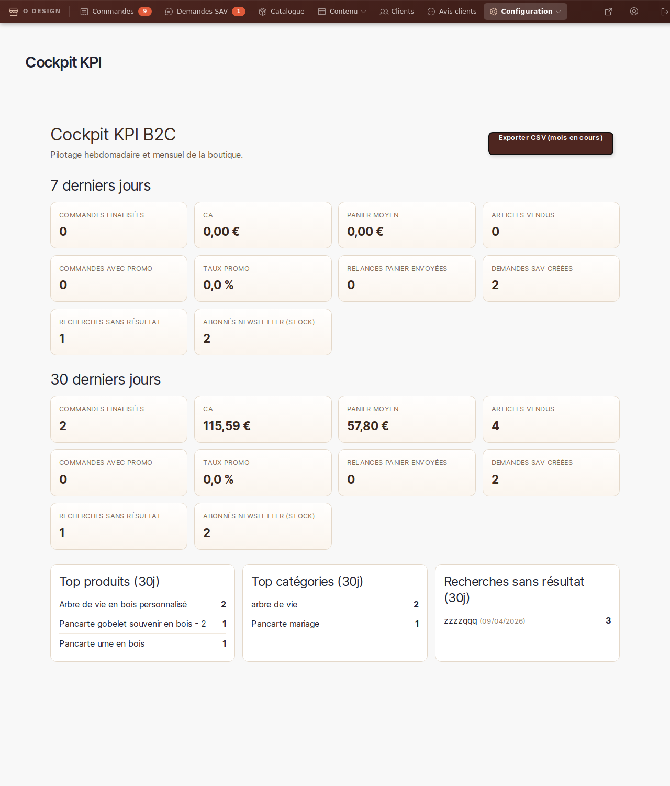
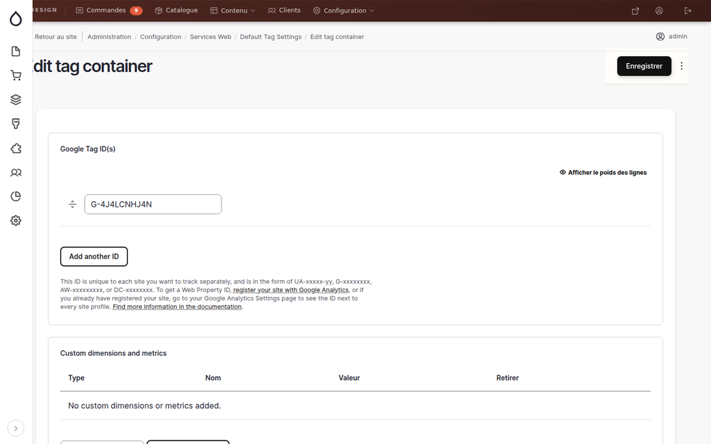

# Suivi analytique GA4 (Google Analytics 4)

> **Rôle concerné** : gestionnaire_boutique (lecture) / administrateur (configuration)

---

## Principe de fonctionnement

Le site intègre **Google Analytics 4** via le module Drupal `google_tag`.

**Règle RGPD** : GA4 ne se charge **que si le visiteur a accepté les cookies** via le bandeau de consentement.
- Si le visiteur clique **"Refuser"** → aucun script Google n'est chargé.
- Si le visiteur clique **"J'accepte"** → GA4 se charge et enregistre les événements.

---

## Cockpit KPI boutique (pilotage hebdomadaire)

> 📍 **Accès** : Navigation gestionnaire → **Statistiques**
> **URL directe** : `/admin/boutique/analytics`

Le cockpit KPI regroupe les indicateurs actionnables sans ouvrir GA4.

Vous y retrouvez :

- une vue **7 jours** et **30 jours**
- le volume de commandes, le CA, le panier moyen
- les commandes avec promotion et le taux promo
- les relances paniers envoyées
- les demandes SAV créées
- les recherches sans résultat
- les tops produits / catégories

### Export mensuel CSV

Le bouton **Exporter CSV (mois en cours)** télécharge un fichier avec un suivi
journalier minimal :

- commandes finalisées
- CA
- panier moyen
- commandes avec promotion
- nombre de recherches sans résultat

Ce fichier sert de base pour votre suivi mensuel.

---

## Propriété GA4 utilisée

| Paramètre | Valeur |
|---|---|
| Property ID | `G-4J4LCNHJ4N` |
| Devise | EUR |
| Langue | FR |
| Pages exclues du tracking | `/admin/*`, `/user/*`, `/batch`, `/system/*` |

---

## Événements e-commerce trackés

| Événement GA4 | Déclencheur |
|---|---|
| `view_item` | Vue d'une fiche produit |
| `add_to_cart` | Soumission du formulaire "Ajouter au panier" |
| `purchase` | Arrivée sur la page `/merci` après un achat complété |

L'événement `purchase` inclut : identifiant de commande, montant total, liste des articles (nom, prix, quantité).

---

## Vérifier que les events arrivent dans GA4

1. Connectez-vous sur [analytics.google.com](https://analytics.google.com)
2. Sélectionnez la propriété **O'Design Création** (`G-4J4LCNHJ4N`)
3. Dans le menu de gauche → **Rapports → Temps réel**
4. Sur le site Drupal, effectuez une action (vue produit, ajout panier)
5. Dans GA4, vous devez voir les événements apparaître dans la vue **Temps réel → Événements**

> ℹ️ Pensez à **accepter les cookies** sur le site avant de tester, sinon GA4 n'est pas chargé.

---

## Changer la propriété GA4

Si vous devez utiliser un autre ID de propriété GA4 :

1. Connectez-vous avec un compte **administrateur**
2. Allez sur `/admin/config/services/google-tag/manage/default`
3. Dans le champ **"Tag IDs"**, remplacez `G-4J4LCNHJ4N` par le nouvel ID
4. Cliquez **Enregistrer**

> ⚠️ Après modification, exportez la config : `ddev exec drush config:export -y`

*Formulaire de configuration du container GA4, accessible via `/admin/config/services/google-tag/manage/default`.*

---

## Architecture technique (pour l'administrateur)

- **Module** : `drupal/google_tag` 2.x
- **Config entity** : `google_tag.container.default` dans `config/sync/`
- **Consentement** : géré par `odesign_admin_page_attachments_alter()` — supprime les librairies `google_tag/*` si le cookie `cookie-agreed` ≠ `2`
- **JS e-commerce** : `web/themes/custom/odesign_base/js/ga4-ecommerce.js`
- **Données commande** : injectées via `drupalSettings.ga4Order` sur `/merci`
- **Cache** : varie sur `cookies:cookie-agreed` pour que le rendu serveur soit cohérent avec le consentement
