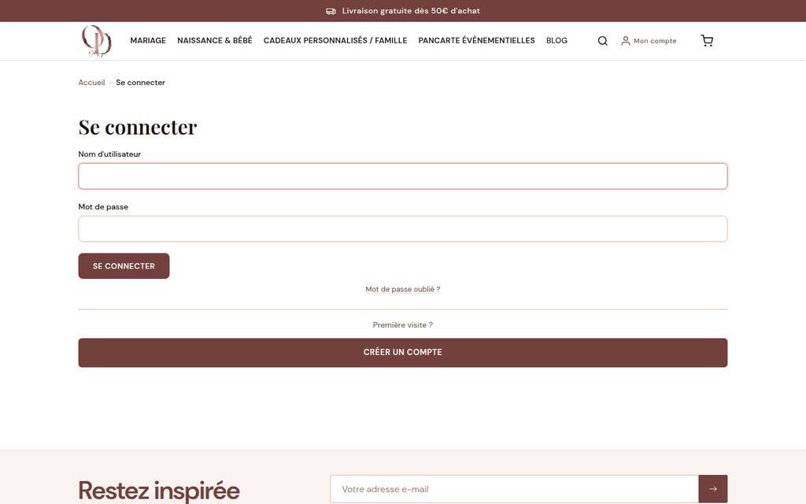
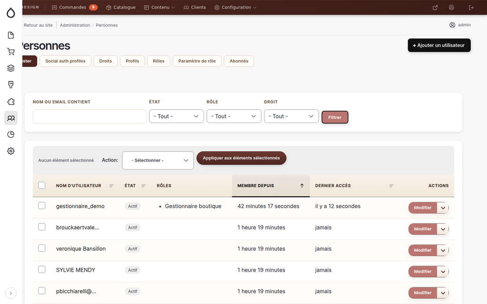

# Connexion Google (SSO)

> 📍 Ce guide explique comment fonctionne la connexion via Google pour vos clients,
> comment activer cette fonctionnalité et comment vérifier les comptes créés.

---

## Ce que voient vos clients

Sur les pages de connexion (`/user/login`) et de création de compte (`/user/register`),
vos clients voient un bouton **"Continuer avec Google"** au-dessus du formulaire classique :

```
┌─────────────────────────────────────┐
│  [G]  Continuer avec Google         │
└─────────────────────────────────────┘
            — ou —
  [ Formulaire email / mot de passe ] 
```

En cliquant sur ce bouton, le client est redirigé vers Google, choisit son compte,
puis revient automatiquement sur le site, connecté. Si c'est sa première connexion,
un compte Drupal est créé automatiquement avec son nom et son email Google.

---

## Prérequis pour activer le bouton Google

Le bouton **n'apparaît pas** tant que vous n'avez pas configuré les credentials Google OAuth.

**Pour activer :**
1. Suivre les étapes du `RUNBOOK-TCK-043-sso-google-setup.md` (dans `notes/`) pour créer l'application OAuth dans Google Cloud Console
2. Saisir le **Client ID** et le **Client Secret** dans Drupal :  
   **Configuration → Social API → Social Auth → Google**  
   URL directe : `/admin/config/social-api/social-auth/google`

Une fois configuré, le bouton apparaît automatiquement.

---

## Vérifier que les nouveaux comptes SSO n'ont pas le rôle gestionnaire

Les comptes créés via Google SSO reçoivent uniquement le rôle **Utilisateur authentifié** (client standard).
Le rôle **gestionnaire_boutique** ne peut **jamais** être attribué automatiquement via SSO.

**Pour vérifier un compte :**
1. Aller dans **Administration → Personnes** (`/admin/people`)
2. Chercher le compte par email
3. Cliquer sur **Modifier** (ou l'icône de crayon)
4. Vérifier la section **Rôles** : seul `Utilisateur authentifié` doit être coché

> ⚠️ Si par erreur un compte SSO avait le rôle gestionnaire, décocher immédiatement
> et enregistrer la modification.

---

## Désactiver la connexion Google

Pour désactiver temporairement ou définitivement la connexion Google :

**Option 1 — Supprimer les credentials (recommandé)**
1. Aller sur `/admin/config/social-api/social-auth/google`
2. Vider le champ **Client ID**
3. Enregistrer → le bouton disparaît immédiatement de la page de connexion

**Option 2 — Désactiver le module**
1. Aller sur **Administration → Extension** (`/admin/modules`)
2. Décocher **"Social Auth Google"**
3. Cliquer sur **"Désinstaller"** (via `/admin/modules/uninstall`)

> ⚠️ Attention : la désinstallation supprime la configuration — il faudra ressaisir
> les credentials si vous souhaitez réactiver plus tard.

---

## Fusion avec un compte existant

Si un client possède déjà un compte Drupal avec le même email que son compte Google :
- Le module `social_auth` **relie automatiquement** les deux comptes
- Le client peut se connecter indifféremment via Google ou via son email/mot de passe

---

## Questions fréquentes

**Le client dit que le bouton Google ne fonctionne pas.**  
→ Demander le message d'erreur exact. Souvent : l'app Google est encore en mode "Test" et l'email du client n'est pas dans la liste des utilisateurs autorisés. Voir Étape 6 du runbook (publier l'app).

**Le client a créé un compte via Google mais ne retrouve pas ses commandes.**  
→ Vérifier que l'email Google utilisé est bien le même que celui lié aux commandes. Si différent, effectuer une fusion manuelle de compte depuis `/admin/people`.

**Le bouton Google n'apparaît pas.**  
→ Vérifier que le Client ID est renseigné dans `/admin/config/social-api/social-auth/google`.

---

## Visuels de référence



*La page `/user/login` sans OAuth configuré. Le bouton "Continuer avec Google" apparaîtra ici une fois le Client ID renseigné dans `/admin/config/social-api/social-auth/google`.*



*Vue administrateur de `/admin/people`. L'onglet "Social auth profiles" permet de vérifier les comptes créés via Google SSO et leurs rôles attribués.*

---

## Références

- Runbook configuration : `notes/RUNBOOK-TCK-043-sso-google-setup.md`
- Module Drupal : [social_auth_google](https://www.drupal.org/project/social_auth_google)
