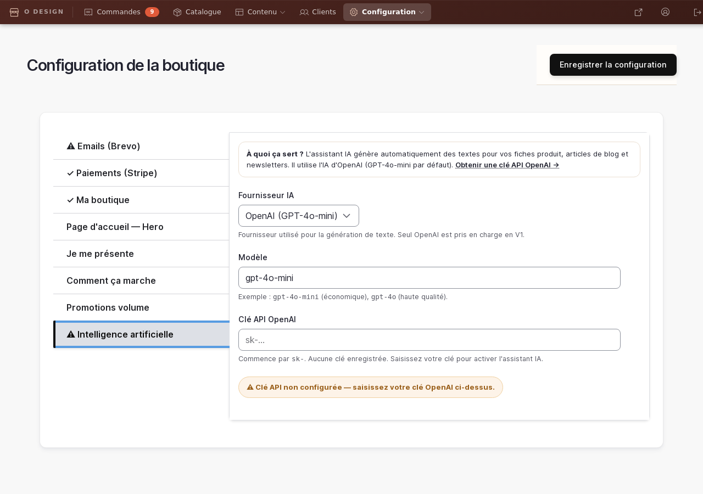
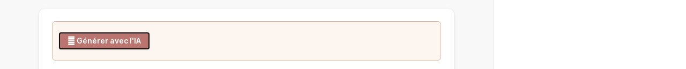

# Assistant IA éditorial

> 📍 **Accès** : Tableau de bord → **Configuration** → onglet **Intelligence artificielle**
> **URL directe** : `/admin/boutique/configuration`

L'assistant IA vous aide à rédiger rapidement des textes pour votre boutique : descriptions de fiches produit, articles de blog, newsletters. Il utilise OpenAI (GPT-4o-mini) avec un ton artisanal et chaleureux adapté à O'Design Création.

---

## Ce que fait l'assistant IA

- **Fiches produit** — génère une description courte (100 mots) valorisant le côté artisanal et personnalisable du produit.
- **Articles de blog** — rédige une introduction (150 mots) à partir d'un thème.
- **Newsletters** — génère un objet email accrocheur et le corps de la newsletter (150–200 mots) avec un CTA.

> ⚠️ **Important** : le texte généré est un point de départ. Relisez toujours le contenu et adaptez-le avant publication.

---

## Configurer l'assistant IA

Avant la première utilisation, saisissez votre clé API OpenAI.

1. Aller dans **Tableau de bord → Configuration** (ou `/admin/boutique/configuration`).
2. Cliquer sur l'onglet **Intelligence artificielle**.
3. Renseigner :
   - **Fournisseur IA** : laisser sur *OpenAI (GPT-4o-mini)*.
   - **Modèle** : `gpt-4o-mini` (économique) ou `gpt-4o` (haute qualité, plus coûteux).
   - **Clé API OpenAI** : votre clé commençant par `sk-`. Obtenez-la sur [platform.openai.com/api-keys](https://platform.openai.com/api-keys).
4. Cliquer sur **Enregistrer la configuration**.

Une fois la clé enregistrée, l'onglet affiche ✅ *Clé API configurée — l'assistant IA est actif.*

> 🔒 Votre clé API n'est jamais exportée ni visible dans les fichiers du site. Elle est stockée de façon sécurisée en base de données.

---

## Utiliser l'IA dans une fiche produit

L'assistant IA est intégré directement dans l'éditeur CKEditor 5 qui sert à rédiger vos fiches produit.

1. Ouvrir ou créer une fiche produit (**Catalogue** dans le menu → bouton **Ajouter un produit**, ou `/admin/boutique/catalogue`).
2. Cliquer sur l'onglet **Description**.
3. Dans la barre d'outils CKEditor 5, repérer le bouton **✦ AI Assistant**.
4. Cliquer sur **AI Assistant** → un panneau s'ouvre. Choisissez le type de génération, puis cliquez sur **Générer**.
5. Le texte généré s'insère dans l'éditeur. Relisez et adaptez avant de sauvegarder.

> 💡 **Astuce** : saisissez d'abord le nom du produit dans le titre, puis utilisez l'IA sur la description pour obtenir un texte cohérent.

---

## Utiliser l'IA pour un article de blog

La procédure est identique à celle des fiches produit. Le bouton **✦ AI Assistant** est disponible dans CKEditor 5 sur tous les types de contenu ayant un champ texte enrichi.

1. Aller dans **Éditorial** (`/admin/boutique/editorial`) → **Créer un article**.
2. Dans le corps de l'article, repérer le bouton **✦ AI Assistant** dans la barre CKEditor 5.
3. Choisissez la génération d'une introduction de blog et renseignez le thème.
4. Relisez et complétez le contenu généré.

---

## Générer une newsletter avec l'IA

Le formulaire de rédaction de newsletter dispose d'un bouton **✨ Générer avec l'IA** dédié.

1. Aller dans **Newsletters** → **Créer une newsletter** (`/node/add/simplenews_issue`).
2. Saisissez d'abord un **titre/thème** dans le champ *Titre* (ex : *Nouveautés printemps — cadeaux pour les mamans*).
3. Cliquez sur le bouton **✨ Générer avec l'IA** en haut du formulaire.
4. L'assistant génère :
   - L'**objet email** (remplace le titre actuel).
   - Le **corps** de la newsletter (intro + contenu + appel à l'action).
5. Un message ✅ *Contenu généré — relisez et adaptez avant envoi.* s'affiche quand la génération est terminée.
6. Relisez le texte, personnalisez les détails (dates, promotions, liens), puis envoyez la newsletter normalement.

---

## Bonnes pratiques

- **Relisez toujours** le texte généré avant de publier ou d'envoyer. L'IA peut commettre des erreurs factuelles.
- **Vérifiez le ton** : l'assistant est configuré pour utiliser le vouvoiement et un ton artisanal, mais quelques ajustements peuvent être nécessaires.
- **Ne publiez pas sans vérifier** les informations clés : prix, dates, disponibilité des produits.
- **Complétez plutôt que remplacez** : l'IA vous donne une base solide, mais votre connaissance du produit et de vos clientes donne la touche personnelle qui fait la différence.
- **Limite de coût** : chaque génération consomme des crédits OpenAI. GPT-4o-mini est très économique (environ 0,002 € par génération). GPT-4o est environ 15× plus cher.

---

## En cas de problème

| Symptôme | Cause probable | Solution |
|---|---|---|
| Le bouton ✨ n'apparaît pas | Permission manquante | Contacter l'administrateur |
| ❌ *La clé API OpenAI n'est pas configurée* | Clé non saisie dans la configuration | Aller dans Configuration → Intelligence artificielle |
| ❌ *Erreur de connexion à l'API IA* | Problème réseau ou clé invalide | Vérifier la clé API dans [platform.openai.com](https://platform.openai.com) |
| Le bouton AI de CKEditor ne génère pas | Module ai_ckeditor non configuré | Contacter l'administrateur pour vérifier `/admin/config/ai/ckeditor` |

---

*Documentation générée pour O'Design Création — Drupal Commerce 11.3.5*
