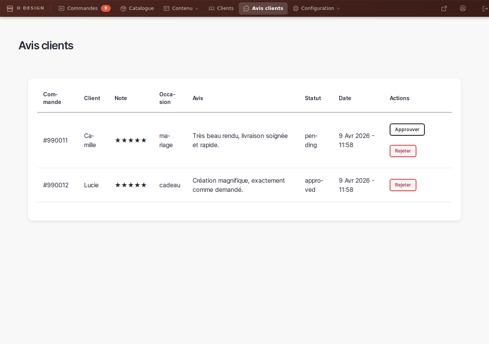
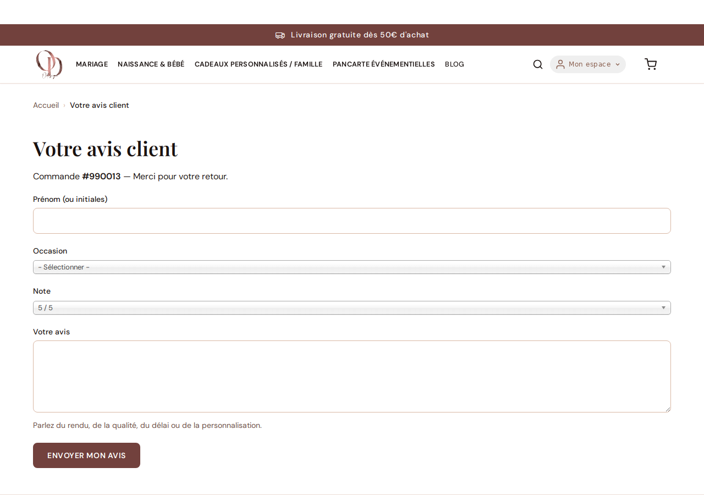

# Avis clients

> **Rôle concerné** : gestionnaire_boutique  
> **Objectif** : valider ou refuser les avis reçus après livraison

## Où aller

`/admin/boutique/avis`

Depuis le tableau de bord boutique, cliquez sur **Avis clients**.

## Ce que vous voyez

La liste affiche, pour chaque avis:

- Numéro de commande
- Prénom (ou initiales) du client
- Note sur 5
- Occasion
- Extrait du message
- Statut (`pending`, `approved`, `rejected`)
- Date

## Comment les avis sont récoltés

Le site collecte les avis automatiquement après la livraison d’une commande:

1. Quand une commande passe au statut **livrée**, le client reçoit un email automatique.
2. Cet email contient un **lien unique** vers un formulaire d’avis lié à cette commande.
3. Le client peut donner:
- un prénom (ou initiales)
- une occasion
- une note sur 5
- un commentaire
4. Après envoi, l’avis arrive en statut **pending** dans votre backoffice.
5. Vous choisissez ensuite de **publier** (approuver) ou **refuser** (rejeter) l’avis.

> Important : le lien d’avis est à usage unique (un avis par commande), pour éviter les doublons.

## Comment modérer un avis

1. Ouvrir la page **Avis clients**
2. Lire l’avis
3. Cliquer sur **Approuver** si le contenu est publiable
4. Cliquer sur **Rejeter** si le contenu n’est pas publiable

## Ce que cela change sur le site

- Les avis **approuvés** peuvent apparaître sur la page d’accueil dans la section **Avis clients**
- Les avis **rejetés** restent en backoffice pour historique

## Bonnes pratiques

- Valider en priorité les avis récents et complets
- Rejeter les avis contenant des données sensibles (email, téléphone)
- Garder une modération cohérente pour conserver une preuve sociale de qualité
