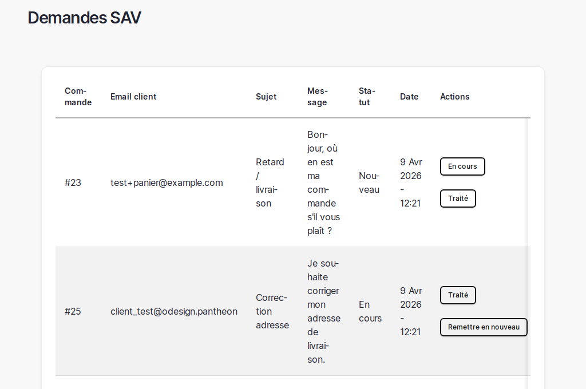

# 17. Demandes SAV

> 📍 **Accès** : Menu navigation gestionnaire → **Demandes SAV**
> **URL directe** : `/admin/boutique/sav`

Ce chapitre explique comment traiter les demandes clients envoyées depuis l'espace client.

---

## À quoi sert cette page

Lorsqu'un client clique sur "J'ai une question sur cette commande", sa demande arrive dans la liste SAV.

Sur la page SAV, vous voyez :

- la commande concernée
- l'email du client
- le sujet de la demande
- le message envoyé
- le statut de traitement
- la date de la demande

---

## Traiter une demande

1. Ouvrez `/admin/boutique/sav`
2. Repérez les demandes au statut **Nouveau**
3. Cliquez sur **En cours** pour prendre en charge la demande
4. Répondez au client (mail ou téléphone selon votre organisation)
5. Cliquez sur **Traité** quand le sujet est résolu

---

## Conseils d'organisation

- Traitez d'abord les demandes les plus anciennes.
- Gardez le statut **Nouveau** uniquement pour les demandes non traitées.
- Utilisez **Remettre en nouveau** si une demande doit être reprise.

---

*Documentation O'Design Création — Demandes SAV — v1.0*
